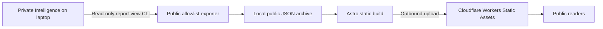

# Zilnon Open

A public reading room for AI-generated US-equity research. Browse company
fundamentals, news and macro analysis, social research, and a searchable report
archive. The initial watchlist is **SNDK, MU, AMD, CRDO, and BE**.

This is the publication layer of the Zilnon concept. The open-source repository
includes a working website, synthetic examples, a strict public export contract,
and a laptop-to-cloud publishing runner. It does not include the private research
backend or claim to be a standalone investment decision system.

## Architecture



Visitors read static pages. They cannot reach the laptop, trigger model calls,
access accounts, or trade. Publication does not change a report's **complete,
unreviewed** status. Research portfolio outputs are not part of this first release.

## Run the demonstration

Requires Node **22.23.4+** and Python **3.10+** on macOS or Linux. Development was
verified with Node 26.5.0. The publisher uses only Python's standard library.

```sh
npm ci
ASTRO_TELEMETRY_DISABLED=1 npm run dev
```

Open **http://127.0.0.1:5180**. The default seven reports are clearly labelled
synthetic; they make no claims about current prices or company performance.
All dependencies are locked. Dependency install scripts are disabled in `.npmrc`.

```sh
npm run check
ASTRO_TELEMETRY_DISABLED=1 npm run preview
```

`check` runs exporter/publisher tests, frontend validation tests, TypeScript, and a
static build. Both dev and preview use port **5180**, so run one at a time.
Build output is `dist/`. Astro's preview command can run in the background;
`npm exec --workspace web -- astro preview stop` stops it.

## Publish real reports from the laptop

The independent private Intelligence producer must expose these existing commands:

| Command | View contract |
| --- | --- |
| `fundamental-report-view --symbol SYMBOL --data-dir PATH` | `FundamentalReportView` 1.0.0 |
| `news-report-view --data-dir PATH` | `NewsReportView` 1.0.0 |
| `social-report-view --data-dir PATH` | `SocialReportView` 1.1.0 |

The exporter executes only those fixed read commands. There are no private package
imports or cross-repository database reads. For another backend, implement those
contracts or produce the [public JSON schema](schemas/publication.schema.json).

Copy `config/publisher.example.json` to `.local/publisher-config.json` and set its
four fields. Use absolute filesystem paths; `project_name` is your Cloudflare
Worker name.
Keep the config and exported reports ignored and local.

```sh
python3 -m publisher.publish --config /ABSOLUTE/PATH/.local/publisher-config.json
```

This exports and builds locally. To build an existing compatible snapshot directly:

```sh
ZILNON_PUBLICATION_FILE=/ABSOLUTE/PATH/catalog.json ASTRO_TELEMETRY_DISABLED=1 npm run build
```

Invalid snapshots fail the build; they never silently fall back to demonstration
content. New report IDs accumulate in the local archive. Repeated IDs preserve
their first publication timestamp; changed contents under the same ID fail export.
Only the latest producer view is collected per run: missed intermediate reports
are not automatically backfilled while the laptop is asleep or off.

## Cloudflare Workers Static Assets deployment

Authenticate directly with Cloudflare; never put credentials in this repository:

```sh
WRANGLER_SEND_METRICS=false npm exec -- wrangler login --scopes account:read user:read workers:write
python3 -m publisher.publish --config /ABSOLUTE/PATH/.local/publisher-config.json --deploy
```

Complete the browser sign-in and authorize Wrangler. The first deployment creates
the Worker under the `project_name` in your local config. If the account has no
`workers.dev` subdomain yet, complete that account setup before unattended uploads.
`wrangler.jsonc` serves only the static files in `dist/`, with no Worker script,
API, database binding, or public connection to the laptop. GitHub contains source
and synthetic fixtures, not the live archive. Existing Pages login permissions do
not grant Worker deployment permission; sign in with the scopes above.
Cloudflare authentication stays in Wrangler's local credential store or its
documented environment variables. Build processes do not receive Cloudflare API
token environment variables. Commit source before deploying: dirty source forces
rebuilding instead of trusting a cached revision.

The runner checks the validated catalog and Git revision, and skips unchanged
successful deployments. Every pending upload builds fresh to prevent an unrelated
demo build from being uploaded. Failed collection, validation, or builds leave
the existing cloud site unchanged; failed uploads are retried on the next run with
a fresh build. `.local/publication-state.json` records successful stages.

## Scheduled publication on macOS

`ops/com.zilnon.open-publisher.plist.template` checks for completed reports every
five minutes and when loaded at login. Its default mode updates the local website
without requiring Cloudflare authentication. It does not generate research.
Replace its placeholders with the
absolute Python executable, config, project, and Node executable directory. Save
the rendered file as `~/Library/LaunchAgents/com.zilnon.open-publisher.plist` after
one successful local publication, then load it:

```sh
launchctl bootstrap "gui/$(id -u)" "$HOME/Library/LaunchAgents/com.zilnon.open-publisher.plist"
launchctl print "gui/$(id -u)/com.zilnon.open-publisher"
```

The source template alone does not activate a background job. Once cloud hosting
is configured and a manual deployment succeeds, add `--deploy` to the installed
job's `ProgramArguments` and reload it. Local updates can run throughout hosting
setup; cloud deployment is an independent step. Reload an already-open browser
page to see newly published reports.

The laptop must be awake and online. Cloudflare continues serving the previous
publication while it is offline. No fresh-report delivery SLA is implied.
Check `.local/publisher.log`, `.local/publisher-error.log`, and the publication state
file for local status. Stop the job with `launchctl bootout` before changing its
configuration. Rotate or remove local logs as needed.

To roll back a cloud release, restore a previous version in the Worker's Deployments
view in the Cloudflare dashboard. Pause the local job first so it cannot republish the
newer version. Back up `.local/publication/catalog.json` if you need to preserve
the public archive; a source checkout alone cannot recover historical reports.

## Publication meaning and boundaries

- Evidence cutoff, generation, and publication timestamps remain separate and are
  displayed in Singapore time. Publication is the report's first admission to the
  public snapshot, not a Cloudflare upload receipt. Date-only source dates remain
  dates; no intraday time is invented.
- Source facts, source claims, and interpretations remain distinct. Citation links
  retain provenance. Raw source bodies and literal citation excerpts are excluded.
- Only explicitly allowed fields cross the boundary. Account data, holdings,
  private review notes, credentials, local paths, model prompts, and operational
  error details are not part of the public contract. Public source coverage gaps
  and analytical limitations remain visible.
- The exporter relies on producer reports containing company/public research in
  their narrative fields. It is not a general-purpose redactor for arbitrary
  private prose. Review a new producer or report format before enabling it.
- The site makes no trade, return, or accuracy guarantee. US-equity decisions and
  executions remain human responsibilities outside this software.

## License

New implementation code is MIT-licensed; see [LICENSE](LICENSE) and [NOTICE](NOTICE).
No private product implementation is vendored here. Dependency licenses remain
their own. Software licensing does not grant redistribution rights to linked
articles, market data, filings, or social content.
